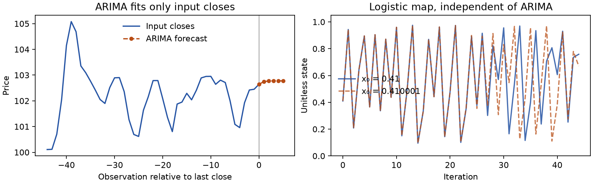

# Chaos Theory & Equity Dynamics

A Python experiment about two different ideas: fitting **ARIMA to closing
prices**, and using a **logistic map** to illustrate sensitive dependence on
initial conditions. The logistic map is not a market model and does not enter
the ARIMA fit. The demo runs on synthetic prices without an API key.



## Quick start

Use **Python 3.12**. The first install downloads packages; the default example
and tests do not need market data or network access after that.

```sh
git clone https://github.com/0xmrpinheiro/chaos-theory-equity-dynamics.git
cd chaos-theory-equity-dynamics
```

On macOS or Linux:

```sh
python3.12 -m venv .venv
. .venv/bin/activate
```

On Windows PowerShell:

```powershell
py -3.12 -m venv .venv
.\.venv\Scripts\Activate.ps1
```

Then install and run:

```sh
python -m pip install -r requirements.txt
python stock_prediction.py --sample --holdout 20 --plot equity-demo.png
```

Open `equity-demo.png` to see the last 45 input closes and the ARIMA projection
on the left. The right panel shows two unitless logistic-map trajectories with
nearby starting points. Neither panel contains real market data in this run.

## Use your own data

```sh
python stock_prediction.py --csv prices.csv --holdout 20
python stock_prediction.py --ticker AAPL --start 2020-01-01 --end 2025-01-01 --holdout 20
```

The CSV must contain `Date`, `Open`, `High`, `Low`, and `Close` columns. Use
consistent price adjustments across those columns and one row per date. The
ticker mode downloads adjusted daily OHLC from Yahoo Finance; `--end` is
exclusive. You need at least 30 closes before the holdout.

## What the results mean

| Output | How to read it |
| --- | --- |
| Recent ATR | The simple average of the last 14 true ranges by default. Each bar takes the largest of high–low, the distance from high to the prior close, or the distance from low to the prior close. The first bar uses high–low only. |
| ARIMA forecast | An ARIMA(1,1,1) fit on the input closes only. The horizon counts subsequent observations, not calendar days. |
| Logistic map | A deterministic, unitless illustration of nearby trajectories diverging. It isn't scaled to the input data and makes no claim about equity prices. |
| Optional holdout | Fit ARIMA only on the prefix and forecast the last `--holdout` observations from one origin. Report MAE and RMSE against a baseline that predicts the final training close at every horizon. The separately printed forward forecast uses all available closes. |

The holdout is a single comparison, not a trading backtest or evidence of
repeatable forecast skill. The synthetic example verifies the workflow, not
market performance. This experiment does not issue trade recommendations.

## Tests

```sh
python -m unittest discover -s tests -v
```

Related public experiments: [Crypto Chaos Dynamics](https://github.com/0xmrpinheiro/chaos-theory-crypto-dynamics)
and the [Market Chaos & Phase-Space Dashboard](https://github.com/0xmrpinheiro/market-chaos-phase-space-dashboard).

Licensed under [GPL-3.0](LICENSE).